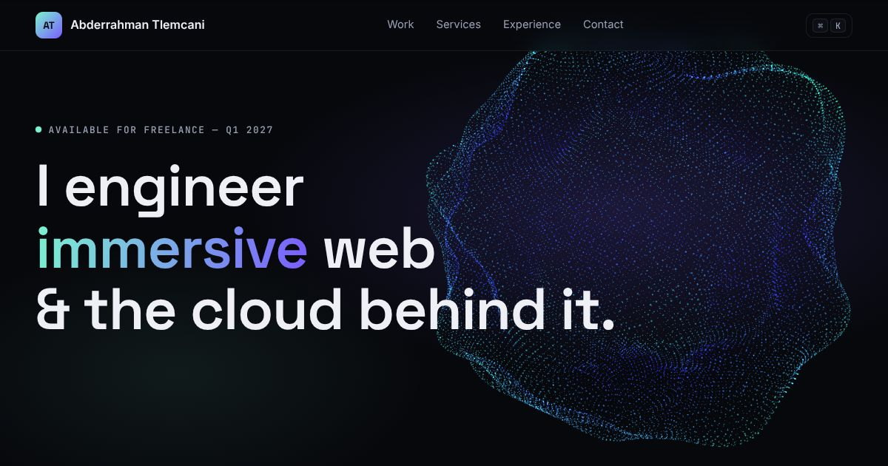

# a-tlemcani.github.io

Personal portfolio of **Abderrahman Tlemcani**: ServiceNow & AI developer who also builds immersive 3D web experiences and the platforms behind them.

**Live → [a-tlemcani.github.io](https://a-tlemcani.github.io/)**



## What's inside
- **GPU particle hero:** 22k points (9k on mobile) displaced by simplex noise in a vertex shader, pointer parallax, and a scroll-driven morph from sphere to ring. Three.js loads lazily after first paint.
- **Selected work** (first tier): Dar Nila (riad showcase with Gaussian-splat scans), Jardin Vittorio (client direct-booking site, Marrakech), and two open demos:
  | Demo | What it shows |
  | --- | --- |
  | [Atelier Nord](https://github.com/A-Tlemcani/atelier-3d-configurator) | 3D product configurator, shareable links, cart |
  | [Orbit](https://github.com/A-Tlemcani/orbit-saas-landing) | SaaS landing, WebGL globe, pricing |
- **Systems & AI lab** (second tier): Digital Brain, Content Factory, flight alerts
- Services, process, experience timeline and skills, all driven by `src/content.ts`
- ⌘K / Ctrl+K command palette, reduced-motion support, no trackers, no cookies

## Engineering
Vite 8 · TypeScript strict · Three.js · self-hosted variable fonts · strict CSP injected at build · GitHub Actions → Pages · Dependabot with a 14-day cooldown · `npm audit` gate. SEO routines live in [`seo/`](seo/README.md).

## Editing content
Everything you read on the site is in [`src/content.ts`](src/content.ts). Lines marked `// VERIFY` need a human check, and `profile.email` / `linkedin` are empty on purpose so nothing personal is published by default.

```bash
npm ci --ignore-scripts && npm run dev
```

MIT licensed (code). Demo brands are fictional.
